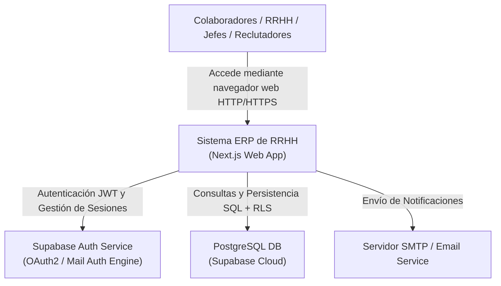
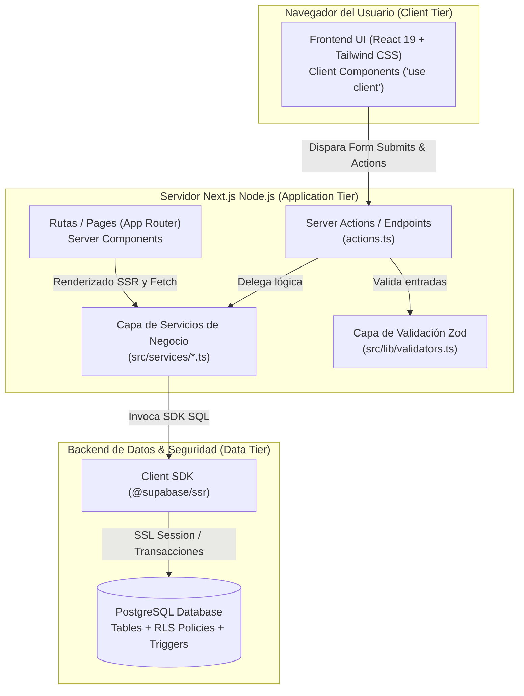
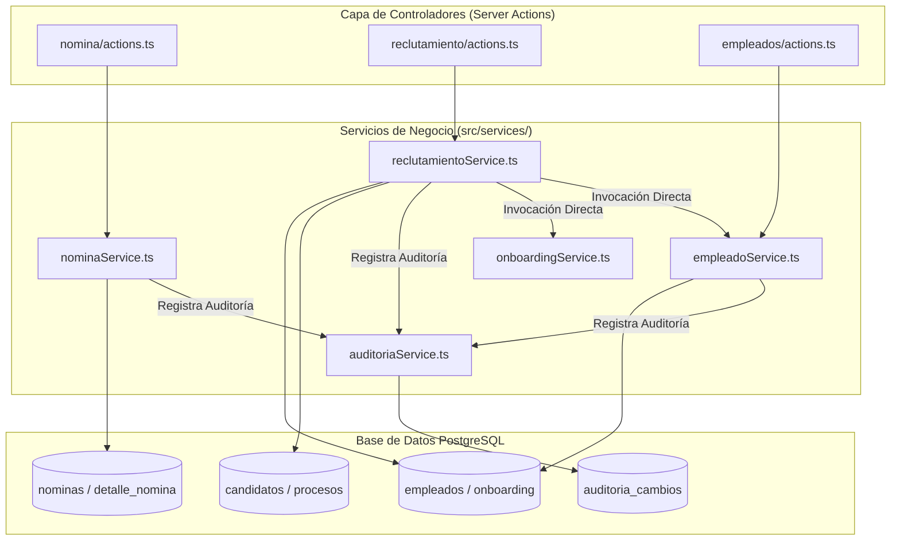

# Informe de Análisis de Arquitectura de Software y Debilidades de Diseño

**Asignatura:** Análisis de Sistemas I  
**Proyecto:** ERP de Gestión de Recursos Humanos (`gestion-rrhh`)  
**Fecha:** 25 de julio de 2026  
**Entregable:** Evaluación de Diseño Arquitectónico y Plan Priorizado de Mejoras  

---

## Introducción

En el contexto del desarrollo de sistemas de información empresariales, la arquitectura de software define la estructura, componentes, relaciones y principios que garantizan la mantenibilidad, escalabilidad, consistencia y robustez de la aplicación a lo largo del tiempo. 

El presente documento tiene como objetivo analizar de forma crítica la arquitectura del **Sistema ERP de Gestión de Recursos Humanos (`gestion-rrhh`)**, identificando las principales debilidades de diseño presentes en la versión MVP actual. A partir del diagnóstico realizado mediante la inspección directa del código fuente, flujos de transacciones y capas de datos, se formula un listado numerado y priorizado de propuestas de cambio arquitectónico orientadas a elevar la calidad del sistema, mitigar riesgos de consistencia de datos y optimizar el rendimiento operacional.

---

## 1. Descripción del Sistema Analizado

### 1.1 Nombre del Sistema
**Sistema ERP de Gestión de Recursos Humanos (`gestion-rrhh`)**

### 1.2 Breve Resumen y Función Principal
El sistema es una plataforma web *Full Stack* orientada a la administración integral del ciclo de vida del colaborador en una organización. Sus módulos funcionales abarcan:
* **Gestión de Empleados**: Expediente digital, estructura organizacional y control de estados (Activo, Inactivo, Suspendido).
* **Gestión de Nómina**: Generación de nóminas periódicas, cálculo de salarios netos, deducciones, retenciones e integración de detalles por empleado.
* **Reclutamiento y Selección**: Control de vacantes, postulación de candidatos, pipeline por etapas y proceso automatizado de alta de empleado.
* **Onboarding**: Asignación y seguimiento de planes de integración para nuevos contratados.
* **Gestión de Ausencias y Asistencia**: Registro de marcas de entrada/salida y procesamiento de solicitudes de vacaciones/permisos.
* **Evaluación de Desempeño, Capacitaciones y Beneficios**: Módulos de desarrollo de personal y compensaciones adicionales.
* **Auditoría y Cumplimiento**: Bitácora histórica de cambios (`auditoria_cambios`) para trazabilidad de mutaciones en tablas críticas.

### 1.3 Arquitectura Actual (Nivel General y Modelos C4)

La solución está construida bajo una arquitectura orientada a la web moderna basada en **Next.js (App Router)** como marco de aplicación y **Supabase (PostgreSQL + Auth + RLS)** como backend de persistencia e identidad.

#### Nivel 1: Diagrama de Contexto de Sistema (C4 Level 1)
Describe las fronteras del sistema, los diferentes actores que interactúan con la plataforma y las integraciones con servicios externos.



#### Nivel 2: Diagrama de Contenedores (C4 Level 2)
Muestra los contenedores tecnológicos que forman la arquitectura de la aplicación y la separación entre la interfaz de usuario, el entorno de ejecución Node.js y la base de datos.



#### Nivel 3: Diagrama de Componentes (C4 Level 3)
Desglosa la estructura interna de la Capa de Servicios (`src/services/`) y su acoplamiento con la base de datos.



---

## 2. Debilidades de Diseño Arquitectónico Identificadas

### Debilidad 1: Ausencia de Transaccionalidad (Atomicidad/ACID) en Operaciones de Negocio Complejas

* **Debilidad detectada**: La capa de servicios ejecuta operaciones compuestas que involucran múltiples inserciones y actualizaciones en distintas tablas mediante llamadas HTTP/REST secuenciales al SDK de Supabase desde el entorno Node.js, sin envolver las operaciones en un bloque de transacción de base de datos (`BEGIN ... COMMIT / ROLLBACK`).
* **Ubicación en el código**: 
  - `src/services/reclutamientoService.ts` en la función `seleccionarCandidato()` (líneas 285-399).
  - `src/services/nominaService.ts` en la función `createNomina()` (líneas 42-105).

* **Evidencia en el código**:
  En `reclutamientoService.ts`:
  ```typescript
  // 3. Crear empleado en la tabla empleados
  const { data: nuevoEmpleado, error: empErr } = await supabase
    .from('empleados')
    .insert([...])
    .select().single();

  // 4. Crear Onboarding en estado PENDIENTE
  const { data: nuevoOnboarding, error: onbErr } = await supabase
    .from('onboarding')
    .insert([...])
    .select().single();

  if (onbErr) {
    // NOTA REAL DEL CÓDIGO FUENTE:
    // "Nota: preferimos no hacer rollback para no invalidar el empleado, o podemos advertir."
    throw new Error('Empleado registrado pero falló la creación de su onboarding: ' + onbErr.message);
  }
  ```
  Si la llamada al onboarding o la posterior actualización del candidato falla (por caída de red, violación de restricción o fallo de servidor), el registro en `empleados` queda insertado en la base de datos pero el sistema queda en un **estado inconsistente**: el empleado existe sin proceso de onboarding asignado, el candidato sigue en estado `EN_PROCESO` y el proceso de reclutamiento permanece `ABIERTO`.

* **Impacto**:
  - **Inconsistencia de Datos (Violación de ACID)**: Datos huérfanos y corruptos en producción.
  - **Filtros Incompletos y Fallos en Cascadas**: Reportes de nómina o métricas de onboarding fallan o muestran discrepancias irreparables sin intervención manual en la base de datos.
  - **Carga Operativa de Soporte**: Necesidad de scripts de limpieza manual para corregir estados inconsistentes.

---

### Debilidad 2: Acoplamiento Fuerte con el SDK de Persistencia (Supabase) y Ausencia de la Capa de Abstracción de Repositorios

* **Debilidad detectada**: Las clases y funciones de la capa de servicio (`src/services/*.ts`) dependen directamente de la implementación concreta del SDK `@supabase/ssr` y de su cliente de consultas (`createSupabaseServerClient()`). No existe una abstracción mediante interfaces (`IRepository`) que desacople la lógica de dominio de las herramientas de persistencia.
* **Ubicación en el código**: 
  - Todos los módulos en `src/services/` (`nominaService.ts`, `reclutamientoService.ts`, `empleadoService.ts`, `asistenciaService.ts`, etc.).

* **Evidencia en el código**:
  Fragmento típico presente en `nominaService.ts`:
  ```typescript
  import { createSupabaseServerClient } from '@/lib/supabaseServer';

  export async function getNominas() {
    const supabase = await createSupabaseServerClient();
    const { data, error } = await supabase
      .from('nominas')
      .select(`*, usuario:usuarios_sistema(correo)`)
      .order('periodo_inicio', { ascending: false });
    ...
  }
  ```
  El código de la lógica de negocio conoce explícitamente los métodos de construcción de consultas propios de Supabase (`.from()`, `.select()`, `.eq()`, `.match()`, códigos de error como `'23505'`).

* **Impacto**:
  - **Dificultad de Pruebas Unitarias (Testability)**: Resulta imposible realizar pruebas unitarias automatizadas (con Jest o Vitest) simulando la capa de datos mediante *Mocks* o *Stubs* sin levantar un servidor o mockear el SDK completo de Supabase.
  - **Alta Rigidez y Vendor Lock-in**: Si en el futuro la organización decide migrar la base de datos a un ORM como Prisma/Drizzle o conectar con un Microservicio REST/gRPC de Nómina, el 100% de los servicios de la aplicación deben ser reescritos desde cero.
  - **Violación del Principio de Inversión de Dependencias (DIP - SOLID)**: Los módulos de alto nivel (negocio) dependen de los módulos de bajo nivel (SDK de base de datos).

---

### Debilidad 3: Cuellos de Botella de Rendimiento por Procesamiento N+1 e Iteración en Memoria Node.js

* **Debilidad detectada**: Se realizan consultas e inserciones repetitivas dentro de bucles secuenciales (`for ... of`) hacia la base de datos en lugar de aprovechar operaciones masivas (*bulk updates/inserts*) o agregaciones nativas en el motor SQL.
* **Ubicación en el código**: 
  - `src/services/reclutamientoService.ts` en `seleccionarCandidato()` (líneas 381-385).
  - `src/services/nominaService.ts` en `recalcularTotalesNomina()` (líneas 183-225).

* **Evidencia en el código**:
  En `reclutamientoService.ts`:
  ```typescript
  if (vinculaciones && vinculaciones.length > 0) {
    const otrosIds = vinculaciones.map(v => v.candidato_id);
    // Bucle N+1: Ejecuta N peticiones HTTP individuales a Supabase
    for (const otId of otrosIds) {
      await updateCandidato(otId, { estado: 'RECHAZADO' });
    }
  }
  ```
  En `nominaService.ts`:
  ```typescript
  // Descarga TODOS los detalles a la memoria de Node.js para sumar en JS
  const { data: detalles } = await supabase.from('detalle_nomina').select(...);
  let total_bruto = 0;
  detalles.forEach(d => { total_bruto += Number(d.salario_base); ... });
  ```

* **Impacto**:
  - **Latencia Exponencial ($O(N)$ HTTP Round-Trips)**: Si una vacante recibe 100 candidatos, al seleccionar un ganador el servidor ejecuta 100 llamadas de red síncronas individuales para actualizar los 99 restantes, provocando un *timeout* en las Server Actions de Next.js.
  - **Consumo Ineficiente de Memoria y CPU**: Descargar miles de registros de detalle de nómina al proceso de Node.js para realizar sumas aritméticas en lugar de ejecutar `SUM()` en el motor PostgreSQL satura la RAM del servidor web.
  - **Baja Escalabilidad**: El sistema no soportará el crecimiento de la plantilla de empleados ni volúmenes reales de nóminas masivas.

---

### Debilidad 4: Acoplamiento Directo Inter-Servicios sin Capa de Mediación o Eventos

* **Debilidad detectada**: Los servicios de negocio se invocan entre sí de forma directa y síncrona. Un módulo funcional (ej. Reclutamiento) asume la responsabilidad de instanciar y controlar el flujo de otros dominios (Empleados, Onboarding, Auditoría).
* **Ubicación en el código**:
  - `src/services/reclutamientoService.ts` en `seleccionarCandidato()`.

* **Evidencia en el código**:
  El servicio de reclutamiento contiene lógica explícita para crear empleados, inicializar registros de onboarding, actualizar estados de candidatos y registrar bitácoras de auditoría de 3 tablas distintas en un único método monolítico:
  ```typescript
  export async function seleccionarCandidato(...) {
    // Lógica de Reclutamiento
    // + Lógica de Empleados
    // + Lógica de Onboarding
    // + Lógica de Auditoría
  }
  ```

* **Impacto**:
  - **Violación del Principio de Responsabilidad Única (SRP)**: El módulo de reclutamiento cambia no solo por reglas de reclutamiento, sino también si cambia el esquema de onboarding o las políticas de auditoría.
  - **Efectos Secundarios Inesperados**: Un fallo o cambio en las firmas de parámetros de `onboardingService` quiebra el flujo completo de contratación.
  - **Dificultad para Extender el Sistema**: Si se desea agregar una nueva acción al contratar (ej. enviar correo de bienvenida, crear cuenta en Active Directory, asignar activo fijo), hay que modificar el código fuente interno de `seleccionarCandidato()`.

---

### Debilidad 5: Manejo Deficiente de Errores, Generación Insegura de Identificadores y Casteos Manuales de Tipos

* **Debilidad detectada**:
  1. Captura de excepciones mediante bloques `try/catch` genéricos que retornan mensajes textuales planos en lugar de clases de error estructuradas con códigos de dominio.
  2. Uso de la función `Math.random()` de JavaScript para la generación de códigos únicos de empleado (`EMP-XXXX`).
  3. Abuso de casteos de tipos (`as Nomina[]`, `as unknown as ...`), evitando la validación estricta de TypeScript.

* **Ubicación en el código**:
  - Generación de código: `src/services/reclutamientoService.ts` (líneas 305-306).
  - Manejo de errores: `src/app/dashboard/nomina/actions.ts` y todos los archivos `actions.ts`.

* **Evidencia en el código**:
  En `reclutamientoService.ts`:
  ```typescript
  // Inseguro: riesgo alto de colisión bajo concurrencia
  const randNum = Math.floor(1000 + Math.random() * 9000);
  const codEmpleado = `EMP-${randNum}`;
  ```
  En `actions.ts`:
  ```typescript
  catch (error: unknown) {
    return { success: false, error: error instanceof Error ? error.message : 'Error desconocido' };
  }
  ```

* **Impacto**:
  - **Riesgo de Colisión en Claves Únicas**: `Math.random()` genera números aleatorios no criptográficos limitados (1000-9999). En un ambiente concurrente, dos contratos simultáneos generarán el mismo código `EMP-4521`, disparando una excepción de clave duplicada en la base de datos.
  - **Experiencia de Usuario Deficiente y Dificultad de Depuración**: Las Server Actions devuelven cadenas de texto genéricas (`"Error al actualizar el detalle"`), ocultando la causa raíz del problema para el desarrollador y el cliente.

---

## 3. Listado de Cambios Priorizados para Mejorar el Sistema

### Criterios de Priorización
* **Alta (P1)**: Crítico para la estabilidad del sistema, corrección de bugs catastróficos, integridad transaccional, seguridad y diseño de la arquitectura base.
* **Media (P2)**: Importante para garantizar la mantenibilidad del código, extensibilidad, rendimiento operacional y desacoplamiento de componentes.
* **Baja (P3)**: Optimizaciones avanzadas, resiliencia estructural, observabilidad y mejoras de calidad no bloqueantes.

---

### Tabla Resumen de Cambios Propuestos

| ID | Cambio Propuesto | Debilidad Atendida | Prioridad | Esfuerzo Estimado |
|---|---|---|---|---|
| **C-01** | Implementación de Transacciones Atómicas mediante Procedimientos Almacenados (RPC SQL) | Debilidad 1 (Falta de Transaccionalidad) | **Alta (P1)** | 16 - 20 hrs (Medio) |
| **C-02** | Generación Atómica de Códigos de Empleado con Secuencias SQL de Base de Datos | Debilidad 5 (Colisiones de `Math.random()`) | **Alta (P1)** | 4 - 6 hrs (Bajo) |
| **C-03** | Arquitectura en Capas con Patrón Repositorio e Inversión de Dependencias (`IRepository`) | Debilidad 2 (Acoplamiento a Supabase) | **Alta (P1)** | 24 - 32 hrs (Alto) |
| **C-04** | Optimización de Consultas N+1 y Agregaciones SQL Nativas para Totales de Nómina | Debilidad 3 (Procesamiento N+1) | **Media (P2)** | 12 - 16 hrs (Medio) |
| **C-05** | Desacoplamiento de Servicios mediante Event Bus / Domain Events (Patrón Mediador) | Debilidad 4 (Acoplamiento Inter-Servicios) | **Media (P2)** | 20 - 24 hrs (Medio) |
| **C-06** | Estandarización de Jerarquía de Errores de Dominio y Middleware de Server Actions | Debilidad 5 (Manejo Deficiente de Errores) | **Media (P2)** | 10 - 12 hrs (Medio) |
| **C-07** | Implementación de Estrategia de Reintentos y Resiliencia en Conexiones de Red | Debilidad 1 / 3 (Fallos de Red) | **Baja (P3)** | 8 - 10 hrs (Bajo) |
| **C-08** | Capa de Caché en Memoria / Redis para Consultas Frecuentes de Lectura | Debilidad 3 (Rendimiento) | **Baja (P3)** | 14 - 18 hrs (Medio) |

---

### Detalle de los Cambios Propuestos (Por Prioridad)

#### PRIORIDAD ALTA (P1)

#### 1. Cambio Propuesto [C-01]: Transacciones Atómicas mediante Procedimientos Almacenados (PostgreSQL RPC)
* **Descripción del Cambio**: Trasladar la ejecución de flujos multitable complejos (como la contratación de un candidato o el procesamiento de nómina) a funciones PL/pgSQL almacenadas en PostgreSQL invocadas vía `supabase.rpc('fn_seleccionar_y_contratar_candidato', { ... })`.
* **Justificación**: Garantiza la atomicidad de las operaciones. Si falla la creación del registro de onboarding, la transacción SQL realiza un `ROLLBACK` automático de la creación del empleado y la actualización del candidato.
* **Impacto Esperado**: Eliminación al 100% de inconsistencias y registros huérfanos en la base de datos. Integridad de datos estricta.
* **Esfuerzo Estimado**: 16 - 20 horas (Esfuerzo Medio).
* **Prioridad**: **Alta (P1)**.

#### 2. Cambio Propuesto [C-02]: Generación Atómica de Códigos de Empleado con Secuencias SQL
* **Descripción del Cambio**: Eliminar el uso de `Math.random()` en Node.js. Crear una secuencia nativa de PostgreSQL (`CREATE SEQUENCE seq_codigo_empleado`) y utilizar un trigger `BEFORE INSERT` o valor por defecto en la tabla `empleados` (ej. `'EMP-' || LPAD(nextval('seq_codigo_empleado')::text, 5, '0')`).
* **Justificación**: Las secuencias de base de datos son atómicas y seguras ante concurrencia multiproceso.
* **Impacto Esperado**: Imposibilidad absoluta de colisión de códigos de empleado. Código correlativo garantizado (`EMP-00001`, `EMP-00002`).
* **Esfuerzo Estimado**: 4 - 6 horas (Esfuerzo Bajo).
* **Prioridad**: **Alta (P1)**.

#### 3. Cambio Propuesto [C-03]: Arquitectura en Capas con Patrón Repositorio (`IRepository`)
* **Descripción del Cambio**: Definir interfaces TypeScript puras para los repositorios de datos (ej. `INominaRepository`, `IEmpleadoRepository`) que declaren las operaciones de lectura y escritura de dominio. Implementar dichas interfaces en clases concretas (`SupabaseNominaRepository`). Los servicios de negocio recibirán el repositorio por inyección de dependencias.
* **Justificación**: Aplica Inversión de Dependencias (DIP). Permite sustituir la implementación de datos sin modificar la lógica de negocio y habilita la creación de *Mocks* para pruebas unitarias automatizadas.
* **Impacto Esperado**: Cohesión alta, desacoplamiento del proveedor de base de datos, 100% de capacidad para pruebas unitarias aisladas.
* **Esfuerzo Estimado**: 24 - 32 horas (Esfuerzo Alto).
* **Prioridad**: **Alta (P1)**.

---

#### PRIORIDAD MEDIA (P2)

#### 4. Cambio Propuesto [C-04]: Optimización de Consultas N+1 y Agregaciones SQL Nativas
* **Descripción del Cambio**:
  1. Reemplazar la actualización en bucle `for` de candidatos rechazados por una consulta masiva SQL: `UPDATE candidatos SET estado = 'RECHAZADO' WHERE id IN (...)`.
  2. Modificar `recalcularTotalesNomina()` para ejecutar un `UPDATE` con subconsulta de agregación nativa `SUM()` directamente en PostgreSQL.
* **Justificación**: Elimina los cuellos de botella de red e iteración en Node.js.
* **Impacto Esperado**: Reducción del tiempo de respuesta en operaciones masivas de $O(N)$ a $O(1)$ peticiones HTTP. Reducción drástica de uso de memoria en el servidor web.
* **Esfuerzo Estimado**: 12 - 16 horas (Esfuerzo Medio).
* **Prioridad**: **Media (P2)**.

#### 5. Cambio Propuesto [C-05]: Desacoplamiento de Servicios mediante Eventos de Dominio (Domain Events)
* **Descripción del Cambio**: Introducción de un emisor de eventos de dominio (ej. `DomainEvents.publish(new CandidatoContratadoEvent(empleadoId))`). Los módulos de Onboarding, Auditoría y Notificaciones se suscribirán como oyentes (*listeners*) independientes.
* **Justificación**: Cumplimiento del Principio de Responsabilidad Única (SRP) y Principio Abierto/Cerrado (OCP). Nuevas acciones ante la contratación se añaden registrando un nuevo suscriptor sin alterar el servicio de reclutamiento.
* **Impacto Esperado**: Alta extensibilidad, código limpio y mantenible.
* **Esfuerzo Estimado**: 20 - 24 horas (Esfuerzo Medio).
* **Prioridad**: **Media (P2)**.

#### 6. Cambio Propuesto [C-06]: Estandarización de Jerarquía de Errores y Wrapper de Server Actions
* **Descripción del Cambio**: Crear clases de error customizadas (`AppError`, `NotFoundError`, `ValidationError`, `ConflictError`). Implementar un *wrapper* de alto nivel para Server Actions que atrape excepciones, registre trazas completas en el servidor y retorne códigos de error estructurados y localizados al cliente web.
* **Justificación**: Evita la pérdida de contexto de fallos y homogeniza las respuestas de la API.
* **Impacto Esperado**: Facilidad de depuración en entornos de producción, feedback claro y preciso en la UI.
* **Esfuerzo Estimado**: 10 - 12 hrs (Esfuerzo Medio).
* **Prioridad**: **Media (P2)**.

---

#### PRIORIDAD BAJA (P3)

#### 7. Cambio Propuesto [C-07]: Estrategia de Reintentos y Resiliencia (Retry / Exponential Backoff)
* **Descripción del Cambio**: Configurar un mecanismo de reintento automático con desinterés exponencial (*exponential backoff*) para consultas de lectura en el cliente de base de datos ante errores transitorios de red.
* **Justificación**: Previene fallos perceptibles por el usuario ante fluctuaciones temporales de conectividad cloud.
* **Impacto Esperado**: Mayor disponibilidad percibida y tolerancia a fallos de red.
* **Esfuerzo Estimado**: 8 - 10 horas (Esfuerzo Bajo).
* **Prioridad**: **Baja (P3)**.

#### 8. Cambio Propuesto [C-08]: Capa de Caché para Consultas Frecuentes de Lectura
* **Descripción del Cambio**: Implementar almacenamiento en caché (utilizando la memoria del servidor o Redis) para catálogos estáticos o consultas de lectura repetitivas (como listas de puestos, departamentos o estructuras de beneficios).
* **Justificación**: Disminuye la carga sobre la base de datos PostgreSQL en consultas de solo lectura.
* **Impacto Esperado**: Reducción de latencia en el renderizado de Server Components de 200ms a <20ms.
* **Esfuerzo Estimado**: 14 - 18 horas (Esfuerzo Medio).
* **Prioridad**: **Baja (P3)**.

---

## 4. Conclusión

El análisis arquitectónico del sistema ERP de Gestión de Recursos Humanos (`gestion-rrhh`) revela que la solución cuenta con una base funcional completa y una adecuada estructuración inicial de componentes y vistas web utilizando tecnologías modernas (Next.js 16 App Router y Supabase PostgreSQL). 

Sin embargo, a nivel de diseño interno y manejo de datos, el sistema presenta debilidades críticas en cuanto a **falta de transaccionalidad atómica**, **acoplamiento directo al SDK de base de datos**, **procesamiento ineficiente N+1 en bucles** y **falta de eventos de dominio**. 

La ejecución del plan de mejoras priorizado en este informe resolverá de forma contundente estos riesgos:
1. **Fase P1 (Inmediata)**: Asegurará la estabilidad operativa y la consistencia de datos mediante procedimientos almacenados atómicos (RPC SQL) y desacoplamiento con el patrón repositorio.
2. **Fase P2 (Mediano plazo)**: Garantizará la escalabilidad del sistema y la facilidad de mantenimiento mediante la eliminación del procesamiento N+1 y el uso de eventos de dominio.
3. **Fase P3 (Largo plazo)**: Optimizará la resiliencia y el tiempo de respuesta general mediante técnicas de caché y tolerancia a fallos.

Adoptar este enfoque de refactorización arquitectónica transformará la aplicación actual en un producto de software de nivel empresarial, altamente mantenible, extensible y preparado para soportar cargas operativas reales de gran escala.
