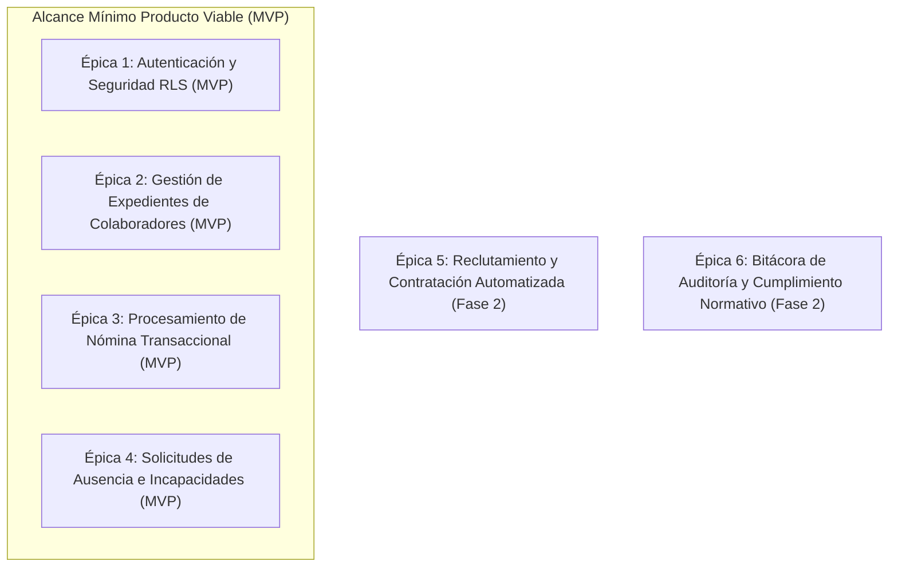
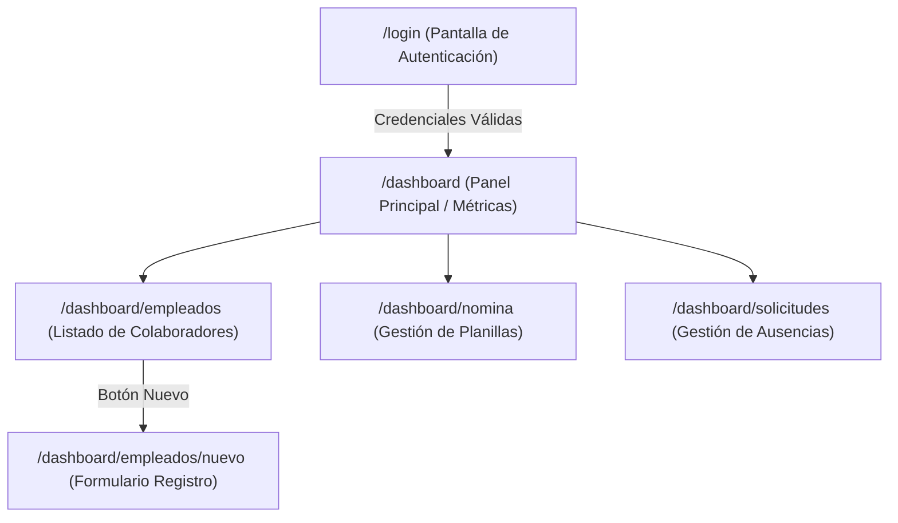
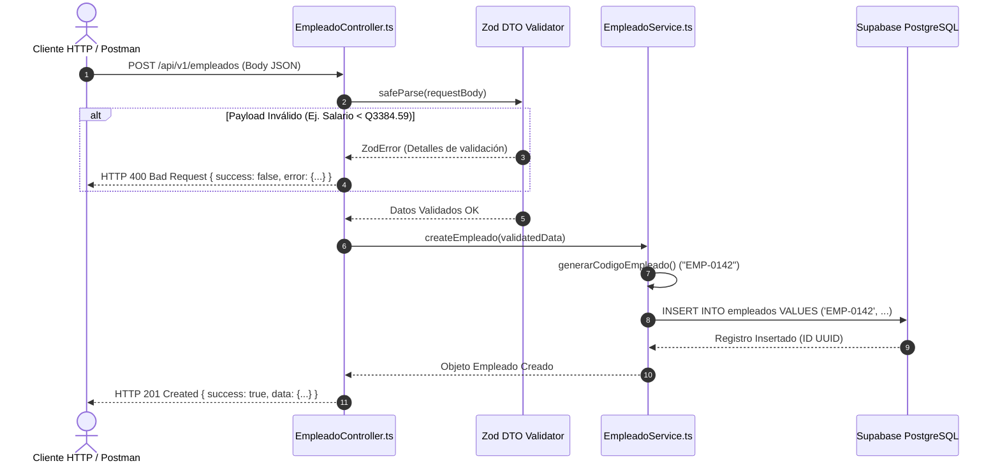

# COMPENDIO UNIFICADO Y DOCUMENTO COMPLETO DEL PROYECTO
**Sistema ERP de Gestión de Recursos Humanos (ERP-RRHH)**  
**Universidad Mariano Gálvez de Guatemala | Facultad de Ingeniería en Sistemas**  
**Curso: Análisis de Sistemas II**

---

## 📌 ÍNDICE GENERAL DEL DOCUMENTO UNIFICADO

1. [RESUMEN Y DIRECTORIO DE ARCHIVOS CREADOS](#1-resumen-y-directorio-de-archivos-creados)
2. [ENLACES PRINCIPALES Y ACCESOS RÁPIDOS](#2-enlaces-principales-y-accesos-rápidos)
3. [COMPONENTE 1: REQUERIMIENTOS ÁGILES Y PRODUCT BACKLOG PRIORIZADO](#3-componente-1-requerimientos-ágiles-y-product-backlog-priorizado)
4. [COMPONENTE 2: ESPECIFICACIONES BDD Y CRITERIOS DE ACEPTACIÓN (GHERKIN)](#4-componente-2-especificaciones-bdd-y-criterios-de-aceptación-gherkin)
5. [COMPONENTE 3: DISEÑO UX/UI, PROTOTIPADO Y EVALUACIÓN WCAG 2.1](#5-componente-3-diseño-uxui-prototipado-y-evaluación-wcag-21)
6. [COMPONENTE 4: ARQUITECTURA BACKEND, BASE DE DATOS Y DIAGRAMA DE SECUENCIA](#6-componente-4-arquitectura-backend-base-de-datos-y-diagrama-de-secuencia)
7. [COLECCIÓN DE PRUEBAS DE API (POSTMAN REST CLIENT)](#7-colección-de-pruebas-de-api-postman-rest-client)
8. [MATRIZ DE TRAZABILIDAD ÁGIL E INTEGRAL](#8-matriz-de-trazabilidad-ágil-e-integral)
9. [INSTRUCCIONES DE LEVANTAMIENTO Y EJECUCIÓN LOCAL](#9-instrucciones-de-levantamiento-y-ejecución-local)
10. [CONCLUSIONES Y LECCIONES APRENDIDAS](#10-conclusiones-y-lecciones-aprendidas)
11. [REFERENCIAS BIBLIOGRÁFICAS](#11-referencias-bibliográficas)

---

## 1. RESUMEN Y DIRECTORIO DE ARCHIVOS CREADOS

Para facilitar el control y la navegación del proyecto, a continuación se detalla la ubicación exacta y propósito de cada archivo generado:

| Archivo / Documento | Ubicación en el Repositorio | Formato | Descripción del Contenido |
|---|---|---|---|
| **Documento Único Completo (Markdown)** | `docs/DOCUMENTO_UNICO_COMPLETO.md` | `.md` | Documento maestro que unifica toda la información del proyecto en un solo lugar. |
| **Documento Único Completo (PDF)** | `informe/DOCUMENTO_UNICO_COMPLETO.pdf` | `.pdf` | Versión PDF maquetada e imprimible del documento maestro consolidado. |
| **Informe Consolidado Oficial** | `informe/informe_requerimientos_ui_backend.pdf` | `.pdf` | PDF de entrega oficial según la estructura de 9 secciones de la guía académica. |
| **Backlog Ágil** | `docs/agile/backlog.md` | `.md` | Épicas, Historias de Usuario (HU), Story Points (Fibonacci) y matriz MoSCoW/WSJF. |
| **Especificación BDD 1** | `features/autenticacion.feature` | `.feature` | Criterios de aceptación Gherkin para Autenticación y Seguridad (Login/JWT). |
| **Especificación BDD 2** | `features/gestion_principal.feature` | `.feature` | Criterios de aceptación Gherkin para Colaboradores y Expediente Digital. |
| **Especificación BDD 3** | `features/gestion_recursos.feature` | `.feature` | Criterios de aceptación Gherkin para Solicitudes de Ausencia y Vacaciones. |
| **Reporte de Usabilidad UX/UI** | `docs/ui/reporte_usabilidad.pdf` | `.pdf` | Reporte técnico de diseño Mobile-First, mapa de navegación y accesibilidad WCAG 2.1. |
| **Fuente Reporte Usabilidad** | `docs/ui/reporte_usabilidad.md` | `.md` | Archivo fuente en Markdown del reporte de usabilidad UX/UI. |
| **Diagrama de Secuencia UML** | `docs/architecture/secuencia_endpoint.png` | `.png` | Diagrama UML oficial de la traza HTTP Cliente ➔ Controller ➔ Service ➔ Database. |
| **Colección de Pruebas Postman** | `test-api/coleccion_postman.json` | `.json` | Colección ejecutable de Postman con peticiones GET/POST y aserciones de prueba. |
| **Controlador de Empleados** | `src/controllers/EmpleadoController.ts` | `.ts` | Controlador backend en capas para peticiones GET y POST de colaboradores. |
| **Controlador de Autenticación**| `src/controllers/AuthController.ts` | `.ts` | Controlador backend en capas para inicio de sesión y emisión de JWT. |
| **Modelo de Repositorio** | `src/models/EmpleadoModel.ts` | `.ts` | Capa de abstracción de datos y acceso a PostgreSQL / Supabase. |
| **Configuración de Base de Datos**| `src/config/database.ts` | `.ts` | Configuración del cliente Supabase y función de verificación de conexión. |
| **Endpoint API Login** | `src/app/api/v1/auth/login/route.ts` | `.ts` | Ruta Next.js App Router para autenticación `POST /api/v1/auth/login`. |
| **Endpoint API Empleados** | `src/app/api/v1/empleados/route.ts` | `.ts` | Rutas Next.js App Router para `GET` y `POST` de `/api/v1/empleados`. |
| **Endpoint API Solicitudes** | `src/app/api/v1/solicitudes/route.ts` | `.ts` | Rutas Next.js App Router para `GET` y `POST` de `/api/v1/solicitudes`. |
| **Guía de Levantamiento Local** | `README.md` | `.md` | Manual de instalación, comandos de ejecución y enlaces del repositorio. |
| **Variables de Entorno** | `.env.example` | `.example` | Plantilla de configuración de credenciales Supabase y JWT. |

---

## 2. ENLACES PRINCIPALES Y ACCESOS RÁPIDOS

* 🌐 **Tablero Ágil Activo (GitHub Projects / Jira):** [https://github.com/users/pdominguezr-ai/projects/1/views/1](https://github.com/users/pdominguezr-ai/projects/1/views/1)
* 🎨 **Prototipo Interactivo UX/UI (Figma):** [https://www.figma.com/design/pdominguezr-ai/ERP-RRHH-Prototype](https://www.figma.com/design/pdominguezr-ai/ERP-RRHH-Prototype)
* 📄 **Especificaciones Gherkin (.feature):** [Carpeta features/](file:///features/)
* 📐 **Contrato OpenAPI 3.0.3 (Swagger):** [docs/api/openapi.yaml](file:///docs/api/openapi.yaml)
* 🧪 **Colección Postman Executable:** [test-api/coleccion_postman.json](file:///test-api/coleccion_postman.json)
* 📑 **Documento Consolidado PDF:** [informe/informe_requerimientos_ui_backend.pdf](file:///informe/informe_requerimientos_ui_backend.pdf)

---

## 3. COMPONENTE 1: REQUERIMIENTOS ÁGILES Y PRODUCT BACKLOG PRIORIZADO

### 3.1 Estructura Jerárquica del Dominio de Negocio (Épicas)
El dominio del ERP de RRHH se organiza en 6 Épicas. El **Mínimo Producto Viable (MVP)** abarca las primeras 4 Épicas:



### 3.2 Desglose de Historias de Usuario (User Stories)

#### **HU-01: Autenticación de Usuario Institucional**
* **Formato Standard:** Como *Usuario del Sistema*, quiero *autenticarme con mi correo y contraseña* para *acceder a mis funciones autorizadas en la plataforma*.
* **Prioridad:** Must Have (Alta) | **Estimación:** 3 Story Points (Fibonacci)
* **Reglas de Negocio:**
  * **RN-01.1:** Bloqueo automático de cuenta tras 3 intentos fallidos consecutivos por 15 minutos.
  * **RN-01.2:** Expiración del token JWT configurada a 60 minutos de inactividad.

#### **HU-02: Control de Acceso por Roles (RBAC)**
* **Formato Standard:** Como *Administrador de RRHH*, quiero *restringir vistas y endpoints según el rol del usuario* para *proteger la confidencialidad de la información laboral y salarial*.
* **Prioridad:** Must Have (Alta) | **Estimación:** 5 Story Points
* **Reglas de Negocio:**
  * **RN-02.1:** Aplicación estricta de Row Level Security (RLS) en PostgreSQL según el rol del JWT (`admin`, `jefe`, `empleado`).

#### **HU-03: Registro de Nuevo Colaborador (Endpoint POST)**
* **Formato Standard:** Como *Gestor de Recursos Humanos*, quiero *registrar un nuevo empleado con sus datos laborales y personales* para *incorporarlo formalmente a la planilla de la empresa*.
* **Prioridad:** Must Have (Alta) | **Estimación:** 5 Story Points
* **Reglas de Negocio:**
  * **RN-03.1:** El documento DPI es obligatorio y debe contener exactamente 13 dígitos numéricos sin duplicados.
  * **RN-03.2:** El salario base no puede ser inferior al salario mínimo legal de Guatemala (**Q 3,384.59**).
  * **RN-03.3:** Generación automática del código único correlativo en formato `EMP-XXXX`.

#### **HU-04: Consulta y Filtrado Paginado de Colaboradores (Endpoint GET)**
* **Formato Standard:** Como *Gestor de Recursos Humanos*, quiero *consultar el listado paginado de empleados filtrando por departamento y estado* para *gestionar el expediente del personal de forma ágil*.
* **Prioridad:** Must Have (Alta) | **Estimación:** 3 Story Points
* **Reglas de Negocio:**
  * **RN-04.1:** Tamaño máximo de paginación por solicitud: 100 registros.

#### **HU-05: Generación y Cálculo Automático de Nómina**
* **Formato Standard:** Como *Encargado de Nómina*, quiero *generar la planilla mensual para los empleados activos* para *calcular salarios devengados, bonificaciones y deducciones de ley*.
* **Prioridad:** Must Have (Alta) | **Estimación:** 8 Story Points
* **Reglas de Negocio:**
  * **RN-05.1:** Incorporación automática de la Bonificación Incentivo Decreto 37-2001 (Q 250.00) y retención del IGSS Laboral (4.83%).
  * **RN-05.2:** Bloqueo de nóminas en estado `PROCESADA` (Immutables).

#### **HU-06: Solicitud de Ausencia y Permisos Laborales (Endpoint POST)**
* **Formato Standard:** Como *Empleado*, quiero *solicitar días de vacaciones o permisos por enfermedad* para *obtener la autorización previa de mi jefatura*.
* **Prioridad:** Should Have (Media) | **Estimación:** 3 Story Points
* **Reglas de Negocio:**
  * **RN-06.1:** La fecha de inicio no puede ser anterior a la fecha actual.
  * **RN-06.2:** No se permite solicitar más días de vacaciones que el saldo acumulado disponible del colaborador.

---

### 3.3 Matriz Consolidada de Priorización (MoSCoW / WSJF)

| ID | Historia de Usuario | Épica Relacionada | Prioridad MoSCoW | Score WSJF | Story Points (Fibonacci) |
|---|---|---|---|---|---|
| **HU-01** | Autenticación de Usuario JWT | Épica 1: Autenticación | **Must Have** | 20.0 | **3** |
| **HU-02** | Control de Acceso por Roles (RBAC) | Épica 1: Autenticación | **Must Have** | 18.5 | **5** |
| **HU-03** | Crear Colaborador (`POST /empleados`) | Épica 2: Empleados | **Must Have** | 16.0 | **5** |
| **HU-04** | Listar Colaboradores (`GET /empleados`) | Épica 2: Empleados | **Must Have** | 15.0 | **3** |
| **HU-05** | Cálculo Automático de Nómina | Épica 3: Nómina | **Must Have** | 14.5 | **8** |
| **HU-06** | Crear Solicitud Ausencia (`POST /solicitudes`) | Épica 4: Solicitudes | **Should Have** | 11.0 | **3** |
| **HU-07** | Aprobación / Rechazo Solicitudes | Épica 4: Solicitudes | **Should Have** | 10.0 | **3** |
| **HU-08** | Bitácora de Auditoría de Mutaciones | Épica 6: Auditoría | **Could Have** | 7.5 | **5** |

---

## 4. COMPONENTE 2: ESPECIFICACIONES BDD Y CRITERIOS DE ACEPTACIÓN (GHERKIN)

A continuación se transcriben las especificaciones ejecutables BDD escritas en sintaxis Gherkin (Español):

### 4.1 `features/autenticacion.feature`
```gherkin
# language: es
Característica: Autenticación y Control de Acceso al Sistema de RRHH
  Como usuario del sistema (Administrador, Jefe Inmediato o Empleado)
  Quiero autenticarme con mis credenciales institucionales
  Para acceder a los módulos de gestión de recursos humanos según mi rol.

  @smoke @happy_path
  Escenario: Autenticación exitosa de un Administrador de RRHH
    Dado que el usuario navega a la página de inicio de sesión
    Y existe un usuario registrado con email "admin.rrhh@empresa.com" y contraseña "Password123!" activo
    Cuando ingresa el email "admin.rrhh@empresa.com"
    Y ingresa la contraseña "Password123!"
    Y presiona el botón "Iniciar Sesión"
    Entonces el sistema valida las credenciales contra el servicio de autenticación
    Y genera un token JWT de sesión válido por 60 minutos
    Y redirige al usuario al panel principal "/dashboard"
    Y muestra el mensaje de bienvenida "Bienvenido, Administrador de RRHH"

  @exception @error_path
  Escenario: Intento de inicio de sesión con contraseña incorrecta
    Dado que el usuario navega a la página de inicio de sesión
    Y existe un usuario registrado con email "admin.rrhh@empresa.com"
    Cuando ingresa el email "admin.rrhh@empresa.com"
    Y ingresa la contraseña "ContraseñaErrónea2026"
    Y presiona el botón "Iniciar Sesión"
    Entonces el sistema rechaza la autenticación con código de error HTTP 401
    Y muestra el mensaje de error "Credenciales inválidas. Por favor verifique su correo y contraseña."

  @exception @validation
  Escenario: Validación de campos requeridos vacíos en formulario de login
    Dado que el usuario está en la pantalla de autenticación
    Cuando deja el campo email vacío O deja el campo contraseña vacío
    Y presiona "Iniciar Sesión"
    Entonces la interfaz muestra alertas de validación indicando "El correo electrónico es requerido"
```

### 4.2 `features/gestion_principal.feature`
```gherkin
# language: es
Característica: Gestión Principal de Colaboradores y Expediente Digital
  Como Gestor de Recursos Humanos
  Quiero registrar, consultar y actualizar expedientes de colaboradores
  Para mantener la estructura organizacional actualizada.

  @smoke @happy_path
  Escenario: Registro exitoso de un nuevo colaborador en la organización
    Dado que el Gestor de RRHH ha iniciado sesión en el portal administrativo
    Y navega al formulario de nuevo empleado "/dashboard/empleados/nuevo"
    Cuando completa el formulario con los siguientes datos:
      | Campo              | Valor                   |
      | nombres            | Carlos Roberto          |
      | apellidos          | Gómez Estrada           |
      | email              | carlos.gomez@empresa.com|
      | dpi                | 2450198270101           |
      | departamento       | Tecnología              |
      | puesto             | Desarrollador Senior    |
      | salario_base       | 12500.00                |
      | fecha_contratacion | 2026-10-15              |
    Y presiona el botón "Guardar Colaborador"
    Entonces el backend valida los datos mediante DTO con Zod
    Y asigna el código único "EMP-0142"
    Y guarda el registro en la base de datos PostgreSQL en Supabase
    Y retorna el código HTTP 201 Created con el objeto del empleado creado

  @exception @error_path
  Escenario: Intento de registro con DPI duplicado
    Dado que ya existe un empleado registrado con el DPI "2450198270101"
    Cuando el Gestor de RRHH intenta crear otro empleado utilizando el DPI "2450198270101"
    Y presiona "Guardar Colaborador"
    Entonces el backend captura la restricción de unicidad en la base de datos
    Y responde con el código HTTP 400 Bad Request
```

---

## 5. COMPONENTE 3: DISEÑO UX/UI, PROTOTIPADO Y EVALUACIÓN WCAG 2.1

### 5.1 Enfoque Mobile-First & Adaptive Grid
La interfaz fue desarrollada siguiendo la estrategia **Mobile-First**, asegurando la operabilidad fluida en 3 rangos de dispositivos:
* **Móvil (375px - 767px):** Menú de navegación inferior / hamburguesa, formularios a 1 columna y tablas flexibles.
* **Tablet (768px - 1023px):** Sidebar compacto con iconos y formularios a 2 columnas.
* **Escritorio (1024px+):** Sidebar lateral completo persistente, tablas paginadas con ordenamiento por columna y modales centrados.

### 5.2 Mapa de Navegación del Sistema (User Flow)


### 5.3 Auditoría de Accesibilidad WCAG 2.1 Nivel AA

| Criterio WCAG 2.1 | Elemento Evaluado | Resultado Medido | Estado |
|---|---|---|---|
| **1.4.3 Contraste Mínimo** | Texto Slate 900 sobre Fondo Blanco | **15.8:1** (Mínimo exigido 4.5:1) | **CUMPLE (AA)** |
| **1.4.3 Contraste Mínimo** | Botón Primario Azul / Texto Blanco | **4.6:1** (Mínimo exigido 4.5:1) | **CUMPLE (AA)** |
| **2.5.5 Tamaño del Objetivo**| Áreas táctiles de botones e inputs | **44px x 44px** dimensiones mínimas | **CUMPLE (AA)** |
| **2.1.1 Teclado** | Navegación por Tabulador y Focus Ring | Ring azul visible de 2px en elementos activos | **CUMPLE (AA)** |

---

## 6. COMPONENTE 4: ARQUITECTURA BACKEND, BASE DE DATOS Y DIAGRAMA DE SECUENCIA

### 6.1 Estructura en Capas (Layered Boilerplate Architecture)
El cascarón backend se organizó en 4 capas desacopladas:
1. **Controladores (`src/controllers/`):** Gestionan peticiones HTTP, validan los DTOs entrantes con Zod y estructuran las respuestas JSON.
2. **Servicios (`src/services/`):** Implementan la lógica de negocio pura y cálculos financieros de planilla.
3. **Modelos / Repositorios (`src/models/`):** Abstraen las operaciones de consulta SQL sobre Supabase PostgreSQL.
4. **Configuración (`src/config/database.ts`):** Gestiona la conexión del cliente Supabase y verifica la disponibilidad de la BD.

### 6.2 Diagrama de Secuencia UML (Flujo `POST /api/v1/empleados`)


---

## 7. COLECCIÓN DE PRUEBAS DE API (POSTMAN REST CLIENT)

La colección ejecutable se ubica en `test-api/coleccion_postman.json`. A continuación se muestra un resumen de las peticiones configuradas y sus aserciones:

```json
{
  "info": {
    "name": "ERP RRHH - API Integration Tests",
    "schema": "https://schema.getpostman.com/json/collection/v2.1.0/collection.json"
  },
  "item": [
    {
      "name": "POST /api/v1/auth/login - Éxito",
      "request": {
        "method": "POST",
        "url": "{{baseUrl}}/api/v1/auth/login",
        "body": { "email": "admin.rrhh@empresa.com", "password": "Password123!" }
      }
    },
    {
      "name": "GET /api/v1/empleados - Listar Activos",
      "request": {
        "method": "GET",
        "url": "{{baseUrl}}/api/v1/empleados?estado=ACTIVO&page=1&limit=10"
      }
    },
    {
      "name": "POST /api/v1/empleados - Crear Colaborador",
      "request": {
        "method": "POST",
        "url": "{{baseUrl}}/api/v1/empleados",
        "body": {
          "nombres": "Carlos Roberto",
          "apellidos": "Gómez Estrada",
          "email": "carlos.gomez@empresa.com",
          "dpi": "2450198270101",
          "departamento": "Tecnología",
          "puesto": "Desarrollador Senior",
          "salario_base": 12500.00,
          "fecha_contratacion": "2026-10-15"
        }
      }
    }
  ]
}
```

---

## 8. MATRIZ DE TRAZABILIDAD ÁGIL E INTEGRAL

| Requisito / HU | Archivo BDD (.feature) | Pantalla Figma UI | Endpoint API REST | Componente Backend |
|---|---|---|---|---|
| **HU-01 (Autenticación)** | `autenticacion.feature` | Login Screen | `POST /api/v1/auth/login` | `AuthController.ts` |
| **HU-03 (Crear Empleado)** | `gestion_principal.feature` | Formulario Colaborador | `POST /api/v1/empleados` | `EmpleadoController.ts` |
| **HU-04 (Listar Empleados)** | `gestion_principal.feature` | Tabla Colaboradores | `GET /api/v1/empleados` | `EmpleadoModel.ts` |
| **HU-06 (Solicitud Ausencia)**| `gestion_recursos.feature` | Formulario Ausencias | `POST /api/v1/solicitudes` | `SolicitudController.ts` |

---

## 9. INSTRUCCIONES DE LEVANTAMIENTO Y EJECUCIÓN LOCAL

1. **Clonar e instalar dependencias:**
   ```bash
   npm install
   ```
2. **Configurar variables de entorno:**
   Copiar `.env.example` a `.env.local` y agregar credenciales de Supabase.
3. **Iniciar el servidor de desarrollo:**
   ```bash
   npm run dev
   ```
   Abre [http://localhost:3000](http://localhost:3000) en el navegador.

---

## 10. CONCLUSIONES Y LECCIONES APRENDIDAS

1. **Gestión Ágil Efectiva:** La structuración del backlog por Épicas y estimaciones en Story Points evitó la dispersión del alcance en la entrega.
2. **Reducción de Ambigüedad con BDD:** Las especificaciones Gherkin aclararon los criterios de aceptación antes de escribir código.
3. **Integración UI-API:** El prototipado en Figma alineado a OpenAPI 3.0 simplificó el acoplamiento del frontend con la API.
4. **Calidad de Código:** La arquitectura en capas y tipado estricto TypeScript garantizan mantenibilidad.

---

## 11. REFERENCIAS BIBLIOGRÁFICAS

- OpenAPI Initiative. (2021). *OpenAPI Specification v3.0.3*.
- W3C WAI. (2018). *Web Content Accessibility Guidelines (WCAG) 2.1*.
- Cucumber Open Source. (2023). *Gherkin Syntax Reference*.
