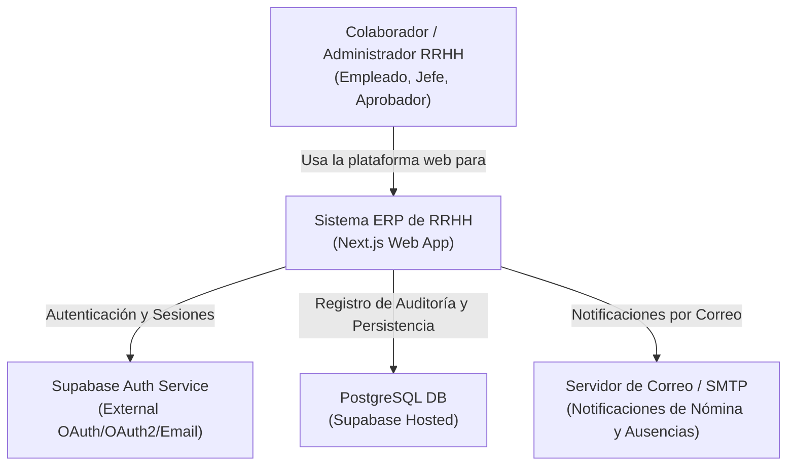
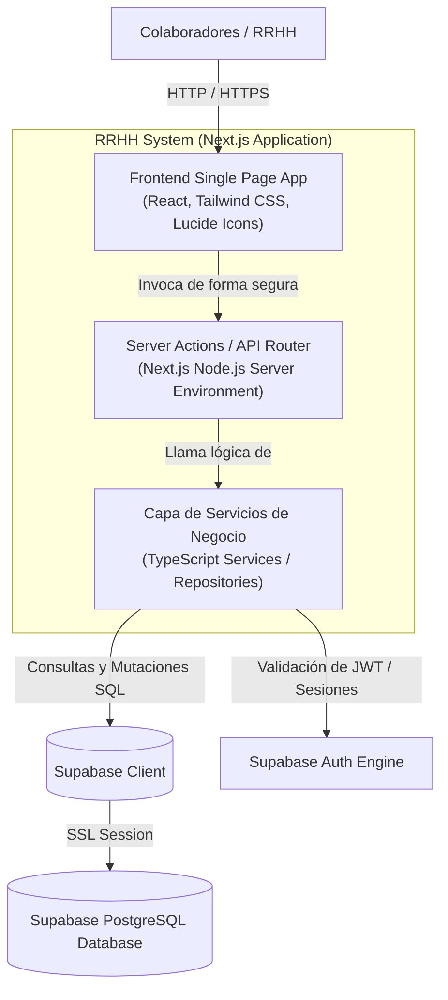
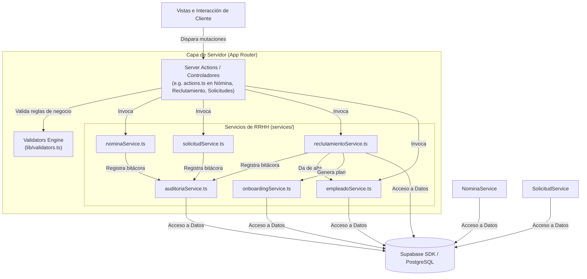
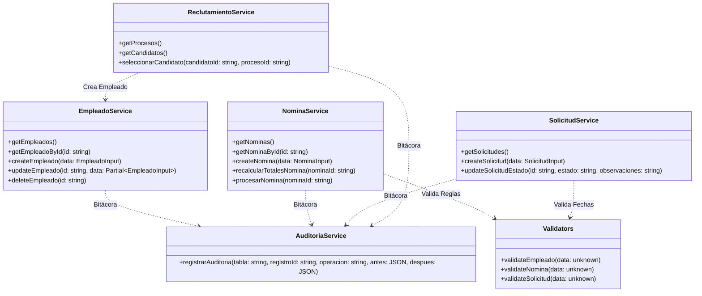
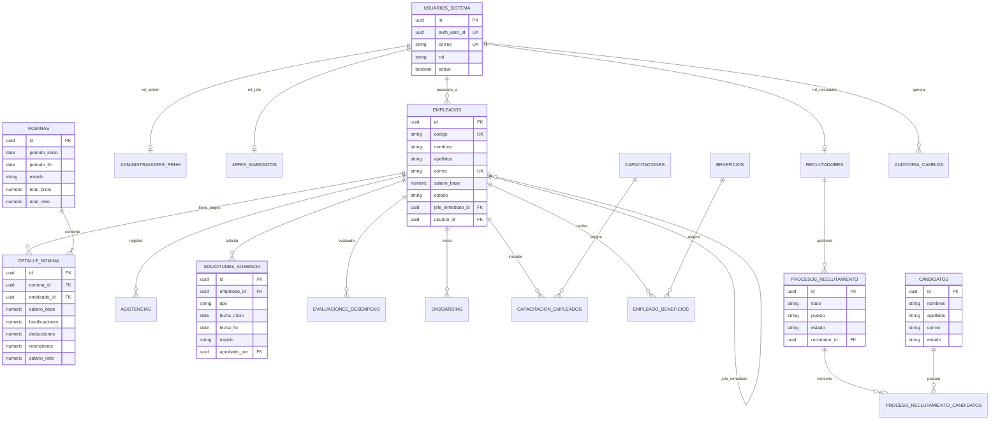

# Diagrama y Modelo C4 del Sistema

Este documento describe la arquitectura de software del sistema de **Gestión de Recursos Humanos** mediante el modelo C4 (Contexto, Contenedor y Componente) utilizando diagramas de bloques Mermaid.

---

## 1. Nivel 1: Diagrama de Contexto de Sistema
Define el alcance del sistema y cómo interactúan los usuarios con él y con sistemas externos.

---

## 2. Nivel 2: Diagrama de Contenedores
Muestra la composición tecnológica detallada del sistema RRHH.

---

## 3. Nivel 3: Diagrama de Componentes
Detalla la estructura interna de la capa de backend de Next.js (`Server Actions` y `Services`) y su comunicación con la base de datos PostgreSQL.

---

## 4. Nivel 4: Diagramas de Código (C4-4)
Descomposición detallada a nivel de clases, entidades de base de datos y flujos de secuencia.

### 4.1 Diagrama de Clases / Arquitectura Interna de TypeScript
Muestra la organización de servicios, capas de validación y repositorios de datos.

---

### 4.2 Diagrama Entidad-Relación (E/R) - Modelo de Datos PostgreSQL
Muestra las tablas principales del esquema relacional en Supabase/PostgreSQL y sus cardinalidades.

---

### 4.3 Diagramas de Secuencia Transaccionales
Los flujos de interacción detallados paso a paso entre el Cliente (UI), Server Actions, Servicios y PostgreSQL se encuentran documentados independientemente en [Diagramas_Secuencia.md](./Diagramas_Secuencia.md):
1. **CU-01 Procesamiento de Nómina**: Validación, cálculo e inactivación de cambios.
2. **CU-02 Aprobación / Rechazo de Ausencia**: Control de estados `PENDIENTE` y registro de justificaciones.
3. **CU-03 Contratación Automática**: Alta de empleado y generación de plan de Onboarding al seleccionar un candidato.

---

## 5. Mapeo de Contenedores a Código Fuente
*   **Frontend SPA (React)**: Ubicado en `src/app/` (vistas e interacciones del cliente con componentes dinámicos e interactivos en TypeScript).
*   **Server Actions**: Implementado en archivos `actions.ts` dentro de cada módulo en `src/app/dashboard/`.
*   **Capa de Servicios / Repositorios**: Ubicado en `src/services/` (`nominaService.ts`, `solicitudService.ts`, `reclutamientoService.ts`, `auditoriaService.ts`).
*   **Persistencia (PostgreSQL)**: Definido en las tablas y triggers del esquema SQL en `supabase/migrations/001_initial_schema.sql`.
