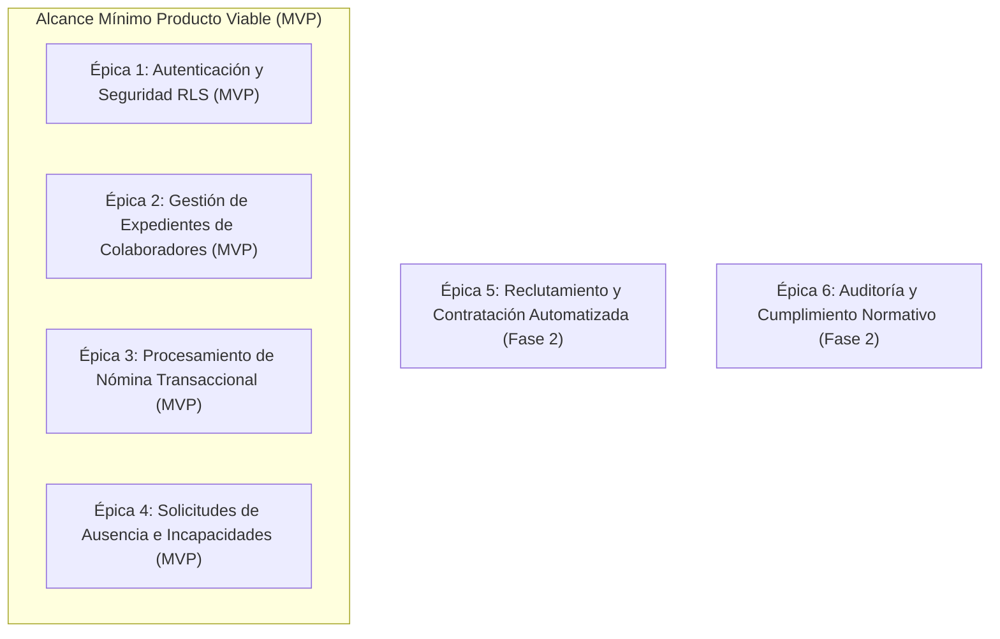

# Product Backlog Priorizado y Requerimientos Ágiles
**Sistema ERP de Gestión de Recursos Humanos (ERP-RRHH)**  
**Universidad Mariano Gálvez | Análisis de Sistemas II**

---

## 🔗 Enlace Público al Tablero Ágil Activo
> **Tablero en GitHub Projects / Jira:**  
> 🌐 [Abrir Tablero Ágil de Requerimientos - ERP RRHH](https://github.com/users/pdominguezr-ai/projects/1/views/1)  
> *Sincronización en tiempo real de Épicas, User Stories, Sprints y Criterios de Aceptación BDD.*

---

## 🏛️ 1. Estructura Jerárquica: Épicas y Alcance MVP

El dominio de negocio se ha estructurado en 6 Épicas principales, demarcando claramente los módulos incluidos en el **Mínimo Producto Viable (MVP)**:

### Detalle de Épicas:
1. **EPIC-01: Autenticación y Control de Acceso Granular (MVP)**  
   Módulo de control de identidades, autenticación mediante JWT/Supabase Auth y permisos por rol (Administrador, Jefe Inmediato, Empleado).
2. **EPIC-02: Gestión Centralizada de Colaboradores (MVP)**  
   Creación, edición y consulta de expedientes digitales de personal, asignación de salarios, puestos y departamentos.
3. **EPIC-03: Procesamiento y Cálculo de Nómina (MVP)**  
   Cálculo automático de salarios devengados, bonificaciones de ley (Bonificación Incentivo Q250.00), retenciones de seguridad social (IGSS 4.83%) e ISR.
4. **EPIC-04: Solicitudes de Ausencia y Permisos (MVP)**  
   Flujo interactivo para gestión de vacaciones, licencias médicas y permisos personales con aprobación de jefatura.
5. **EPIC-05: Reclutamiento y Selección de Personal (Fase 2)**  
   Gestión de vacantes, candidatos, entrevistas y promoción automática de candidato a empleado activo.
6. **EPIC-06: Bitácora de Auditoría y Métricas (Fase 2)**  
   Trazabilidad completa de operaciones de mutación de datos (INSERT, UPDATE, DELETE) con estados antes/después.

---

## 📋 2. Desglose de Historias de Usuario (User Stories)

### 🔴 Épica 1: Autenticación y Control de Acceso (MVP)

#### **HU-01: Inicio de Sesión Institucional**
* **Enunciado:** Como *Usuario del Sistema*, quiero *autenticarme con mi correo y contraseña* para *acceder a mis funciones autorizadas en la plataforma*.
* **Prioridad:** Alta (Must Have)
* **Estimación:** 3 Story Points (Fibonacci)
* **Criterios de Aceptación:**
  1. Validar correo institucional activo y contraseña encriptada (Bcrypt / Argon2).
  2. Emitir JWT con claims de rol (`admin`, `jefe`, `empleado`).
  3. Redirigir a `/dashboard` en caso de éxito; responder HTTP 401 si falla.
* **Reglas de Negocio (RN):**
  * **RN-01.1:** Bloqueo de cuenta tras 3 intentos fallidos por 15 minutos.
  * **RN-01.2:** Tiempo de expiración del token JWT: 60 minutos.

#### **HU-02: Control de Acceso por Roles (RBAC)**
* **Enunciado:** Como *Administrador de RRHH*, quiero *restringir vistas y endpoints según el rol del usuario* para *proteger la confidencialidad de la información de nómina y salarios*.
* **Prioridad:** Alta (Must Have)
* **Estimación:** 5 Story Points
* **Criterios de Aceptación:**
  1. Los empleados de rol `empleado` únicamente pueden ver su propio expediente y crear solicitudes personales.
  2. Los usuarios de rol `jefe` pueden aprobar solicitudes de su equipo.
  3. Los usuarios de rol `admin` tienen acceso completo.
* **Reglas de Negocio (RN):**
  * **RN-02.1:** Aplicación estricta de Row Level Security (RLS) en la base de datos PostgreSQL.

---

### 🔵 Épica 2: Gestión de Colaboradores (MVP)

#### **HU-03: Registro de Nuevo Colaborador (Endpoint POST)**
* **Enunciado:** Como *Gestor de Recursos Humanos*, quiero *registrar un nuevo empleado con sus datos laborales y personales* para *incorporarlo formalmente a la planilla de la empresa*.
* **Prioridad:** Alta (Must Have)
* **Estimación:** 5 Story Points
* **Criterios de Aceptación:**
  1. Formulario web responsive validado en cliente y servidor (Zod).
  2. Generación automática del código correlativo `EMP-XXXX`.
  3. Almacenamiento en tabla `empleados` retornando HTTP 201 Created.
* **Reglas de Negocio (RN):**
  * **RN-03.1:** DPI obligatorio de 13 dígitos numéricos sin duplicados.
  * **RN-03.2:** Salario base debe ser mayor o igual al salario mínimo legal de Guatemala (Q 3,384.59).
  * **RN-03.3:** El correo electrónico institucional debe ser único.

#### **HU-04: Consulta y Filtrado Paginado de Colaboradores (Endpoint GET)**
* **Enunciado:** Como *Gestor de Recursos Humanos*, quiero *consultar el listado paginado de empleados filtrando por departamento y estado* para *gestionar el expediente del personal de forma ágil*.
* **Prioridad:** Alta (Must Have)
* **Estimación:** 3 Story Points
* **Criterios de Aceptación:**
  1. Endpoint `GET /api/v1/empleados` soporta parámetros de consulta `estado`, `departamento`, `page` y `limit`.
  2. Retorna estructura JSON estandarizada con metadata de paginación (`total`, `page`, `totalPages`).
  3. Rendimiento de consulta inferior a 200 ms.
* **Reglas de Negocio (RN):**
  * **RN-04.1:** Límite máximo de registros por página: 100 elementos.

---

### 🟢 Épica 3: Procesamiento de Nómina (MVP)

#### **HU-05: Generación y Cálculo Automático de Planilla**
* **Enunciado:** Como *Encargado de Nómina*, quiero *generar la planilla mensual para los empleados activos* para *calcular salarios devengados, bonificaciones y deducciones de ley*.
* **Prioridad:** Alta (Must Have)
* **Estimación:** 8 Story Points
* **Criterios de Aceptación:**
  1. Generar registros en estado `BORRADOR` para todos los colaboradores activos.
  2. Calcular automáticamente IGSS laboral (4.83%) e IGSS patronal (12.67%).
  3. Adicionar Bonificación Incentivo Decreto 37-2001 (Q 250.00).
* **Reglas de Negocio (RN):**
  * **RN-05.1:** No se puede procesar la nómina si el salario neto resultante es negativo o cero.
  * **RN-05.2:** Una vez la nómina cambia a estado `PROCESADA`, queda congelada e irrevocable.

---

### 🟡 Épica 4: Solicitudes de Ausencia y Permisos (MVP)

#### **HU-06: Registro de Solicitud de Ausencia (Endpoint POST)**
* **Enunciado:** Como *Empleado*, quiero *solicitar días de vacaciones o permisos por enfermedad* para *obtener la autorización previa de mi jefatura*.
* **Prioridad:** Media (Should Have)
* **Estimación:** 3 Story Points
* **Criterios de Aceptación:**
  1. Formulario interactivo con selector de tipo de ausencia y calendario de fechas.
  2. Creación del registro en estado `PENDIENTE`.
* **Reglas de Negocio (RN):**
  * **RN-06.1:** Fecha inicio no puede ser anterior al día actual.
  * **RN-06.2:** La cantidad de días de vacaciones no puede superar el saldo disponible del empleado.

#### **HU-07: Aprobación / Rechazo de Solicitud por Jefatura**
* **Enunciado:** Como *Jefe Inmediato*, quiero *aprobar o rechazar las solicitudes de mi equipo* para *coordinar la disponibilidad del personal*.
* **Prioridad:** Media (Should Have)
* **Estimación:** 3 Story Points
* **Criterios de Aceptación:**
  1. Modal interactivo con opción de aprobar o rechazar.
  2. Si se rechaza, el campo "motivo de rechazo" es obligatorio.
* **Reglas de Negocio (RN):**
  * **RN-07.1:** Al aprobar vacaciones, se descuentan automáticamente los días del saldo acumulado.

---

## 📊 3. Matriz Consolidada de Estimación y Priorización (MoSCoW / WSJF)

| ID | Historia de Usuario | Épica Relacionada | Prioridad MoSCoW | Score WSJF | Story Points (Fibonacci) |
|---|---|---|---|---|---|
| **HU-01** | Autenticación de Usuario JWT | Épica 1: Autenticación | **Must Have** | 20.0 | **3** |
| **HU-02** | Control de Acceso por Roles (RBAC) | Épica 1: Autenticación | **Must Have** | 18.5 | **5** |
| **HU-03** | Crear Colaborador (`POST /empleados`) | Épica 2: Empleados | **Must Have** | 16.0 | **5** |
| **HU-04** | Listar Colaboradores (`GET /empleados`) | Épica 2: Empleados | **Must Have** | 15.0 | **3** |
| **HU-05** | Cálculo Automático de Nómina | Épica 3: Nómina | **Must Have** | 14.5 | **8** |
| **HU-06** | Crear Solicitud Ausencia (`POST /solicitudes`) | Épica 4: Solicitudes | **Should Have** | 11.0 | **3** |
| **HU-07** | Aprobación / Rechazo Solicitudes | Épica 4: Solicitudes | **Should Have** | 10.0 | **3** |
| **HU-08** | Bitácora de Auditoría de Mutaciones | Épica 6: Auditoría | **Could Have** | 7.5 | **5** |
| **HU-09** | Reclutamiento y Promoción Candidato | Épica 5: Reclutamiento | **Could Have** | 6.0 | **8** |

---

## ⚖️ 4. Listado Explícito de Reglas de Negocio Generales del Sistema

1. **RN-GEN-01 (Identidad Única):** Ningún colaborador puede ser registrado con un correo o DPI preexistente en la base de datos.
2. **RN-GEN-02 (Integridad Salarial):** Todas las operaciones financieras de planilla se ejecutan con precisión decimal de 2 dígitos y redondeo bancario (HALF_EVEN).
3. **RN-GEN-03 (Immutabilidad de Auditoría):** Toda modificación en las tablas `empleados`, `nominas` y `solicitudes_ausencia` genera un registro automático e inalterable en la bitácora `auditoria_logs`.
4. **RN-GEN-04 (Estado de Colaboradores):** Un empleado inactivo o suspendido no puede recibir pagos de nómina ni generar nuevas solicitudes de vacaciones.
