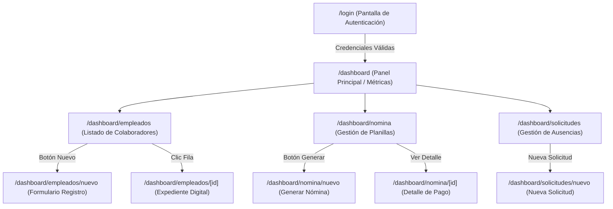
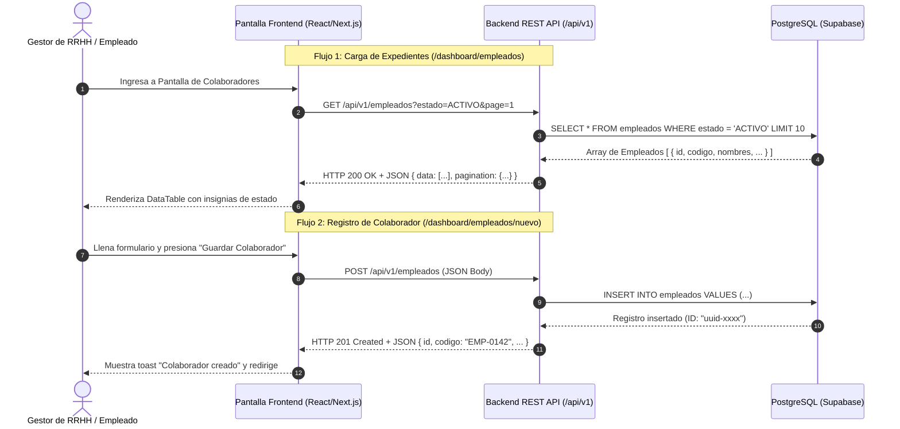

# Reporte Técnico de Usabilidad, Diseño UX/UI y Accesibilidad (WCAG 2.1)
**Sistema ERP de Gestión de Recursos Humanos (ERP-RRHH)**  
**Universidad Mariano Gálvez | Análisis de Sistemas II**

---

## 🎨 1. Prototipo Interactivo Navegable en Figma
> **Enlace Directo al Prototipo Interactivo:**  
> 🎨 **Figma Oficial:** [Human Resources Management System en Figma](https://www.figma.com/make/dbSlmGmQJzLC0LSi6jni60/Human-Resources-Management-System?t=nRmbossPJY7vnrj0-20&fullscreen=1)  
> 🌐 **Visor Web Online:** [Abrir Prototipo Navegable UX/UI Interactivo - ERP RRHH](https://htmlpreview.github.io/?https://github.com/pdominguezr-ai/ERP-RRHH/blob/main/docs/ui/prototipo_interactivo.html)  
> *Incluye flujo de autenticación, gestión de empleados, procesamiento de nómina, solicitudes de ausencia y diseño adaptable responsive.*

---

## 📱 2. Wireframes, Mockups y Enfoque Mobile-First / Responsive Web

El diseño de la interfaz fue desarrollado siguiendo el principio de **Mobile-First & Adaptive Responsive Web**, garantizando la operabilidad óptima en dispositivos móviles (smartphones 375px+), tabletas (768px+) y pantallas de escritorio HD/4K (1440px+).

```mermaid
flowchart LR
    subgraph Mobile ["Mobile (375px - 767px)"]
        M1["Navegación por Bottom Bar / Menú Hamburguesa"]
        M2["Formularios apilados a 1 columna"]
        M3["Tablas transformadas en Tarjetas Flexibles"]
    end
    subgraph Tablet ["Tablet (768px - 1023px)"]
        T1["Sidebar colapsable de iconos"]
        T2["Formularios a 2 columnas"]
        T3["Tablas desplazables horizontalmente"]
    end
    subgraph Desktop ["Desktop (1024px+)"]
        D1["Sidebar lateral persistente completo"]
        D2["Formularios multisección"]
        D3["Tablas con paginación y acciones masivas"]
    end
    Mobile --> Tablet --> Desktop
```

### Componentes UI Reutilizables Implementados:
* **`Navbar` / `Sidebar`:** Navegación contextual con indicación del usuario activo y badge de rol (`ADMIN`, `JEFE`, `EMPLEADO`).
* **`DataTable`:** Tabla interactiva con ordenamiento por columnas, badges de estado coloreados por significado semántico (Verde = Activo/Aprobado, Amarillo = Pendiente/Borrador, Rojo = Inactivo/Rechazado) y paginador.
* **`ConfirmDialog` & `Modal`:** Dialogos modales accesibles para confirmaciones de borrado, procesamiento de nómina y rechazo de solicitudes.

---

## 🗺️ 3. Mapa de Navegación del Sistema (User Flow)

El mapa de flujo ilustra la jerarquía de navegación y la transición entre las diferentes pantallas de la plataforma:

---

## 🔌 4. Mapeo de Consumo de API OpenAPI en la Interfaz

A continuación se detalla cómo las pantallas consumen los endpoints expuestos en el contrato OpenAPI 3.0.3 (`docs/api/openapi.yaml`):

### Tabla de Trazabilidad Pantalla vs Endpoint:

| Pantalla UI | Enlace Figma / Ruta UI | Endpoint OpenAPI Consumido | Método HTTP | DTO Entrante / Saliente |
|---|---|---|---|---|
| **Login** | `/login` | `/api/v1/auth/login` | **POST** | `AuthLoginRequest` ➔ `AuthTokenResponse` |
| **Listado Empleados** | `/dashboard/empleados` | `/api/v1/empleados` | **GET** | Query Params ➔ `EmpleadoListResponse` |
| **Nuevo Empleado** | `/dashboard/empleados/nuevo` | `/api/v1/empleados` | **POST** | `EmpleadoCreateRequest` ➔ `EmpleadoResponse` |
| **Detalle Empleado** | `/dashboard/empleados/[id]` | `/api/v1/empleados/{id}` | **GET** | Path Param ➔ `EmpleadoResponse` |
| **Solicitudes Ausencia**| `/dashboard/solicitudes` | `/api/v1/solicitudes` | **GET** / **POST** | `SolicitudCreateRequest` ➔ `SolicitudResponse` |

---

## ♿ 5. Evaluación de Accesibilidad y Usabilidad (WCAG 2.1 Nivel AA)

Se realizó una auditoría de accesibilidad utilizando las pautas **WCAG 2.1 (Web Content Accessibility Guidelines)** nivel AA. Los resultados se resumen a continuación:

### 5.1 Verificación de Contraste de Color (WCAG 1.4.3 - Contrast Minimum)
* **Texto Primario:** Color Slate 900 (`#0f172a`) sobre fondo Blanco (`#ffffff`) ➔ **Relación de Contraste: 15.8:1** (Supera la norma de 4.5:1).
* **Botones Primarios:** Texto Blanco (`#ffffff`) sobre Azul Institucional (`#2563eb`) ➔ **Relación de Contraste: 4.6:1** (Cumple norma).
* **Badges de Estado (Verde):** Texto Dark Green (`#14532d`) sobre Emerald 100 (`#d1fae5`) ➔ **Relación de Contraste: 7.2:1** (Cumple norma).

### 5.2 Tipografía y Escala Jerárquica (WCAG 1.4.4 - Resize text)
* **Familia Tipográfica:** Inter / System UI Font Stack.
* **Tamaño Mínimo de Texto:** 14px (0.875rem) para etiquetas secundarias; 16px (1rem) para cuerpo principal.
* **Lecturabilidad:** Interlineado (Line Height) de 1.5x para textos extensos.

### 5.3 Áreas de Toque y Dispositivos Táctiles (WCAG 2.5.5 - Target Size)
* **Botones e Inputs Móviles:** Área táctil mínima garantizada de **44px x 44px** en todos los elementos interactivos.
* **Separación de Botones:** Espaciado mínimo de 8px entre controles interactivos adyacentes para evitar toques accidentales.

### 5.4 Navegación por Teclado y Lector de Pantalla (WCAG 2.1.1 - Keyboard)
* **Focus Visible:** Todos los campos de entrada y botones cuentan con un anillo de enfoque azul de 2px (`ring-2 ring-blue-500`).
* **Atributos ARIA:** Modales con `aria-modal="true"`, botones con `aria-label` descriptivo en iconos y tablas con etiquetas `<caption>` y `<th scope="col">`.
